<p align="center">
<picture>
  <source media="(prefers-color-scheme: dark)" srcset="../assets/banner-dark.svg">
  
</picture>
</p>

I'm **Raphaël** ([@rlvdx](https://github.com/rlvdx)), a DevOps/back-end dev in Nantes, France, by day at Guest Suite. I care about two things and refuse to pick one: **happy users** and **calm developers**.

This org is where the things I build with Claude Code grow up and go public. One human on the day shift, agents on the night shift.

### Agent tooling that keeps sessions in their smart zone

**[claude-plugins](https://github.com/FunDrivenDev/claude-plugins)** is my Claude Code plugin marketplace. `handover` passes a session to a fresh one before its context fills up, instead of auto-compacting it. `session-panel` comes along too.

```text
/plugin marketplace add FunDrivenDev/claude-plugins
```

<details>
<summary>Still in the workshop</summary>

- **defactory**: a predictable line around non-deterministic workers. Claude Code sessions work the Stations (Detective, Architect, Worker, Judge…), deterministic Rust code runs the line, because *the orchestrator is never an LLM*.
- **wesh**: a macOS pro tool to steer several Claude Code sessions at once against Linear issues.
- **fundrivenOS**: how we work, as Markdown for agents.
- **linear-triage-bench**: LLM triage of issues, benchmarked. Models judged by models.

</details>

### Small keyboard-driven macOS apps, one stack

**MOSST** stands for macOS, Svelte, Tauri. The apps ship as the "Fun Driven Stuff" casks of **[homebrew-tap](https://github.com/FunDrivenDev/homebrew-tap)**, and **memo**, a reader for the plans, handoffs and reports Claude Code writes, is on tap:

```sh
brew install fundrivendev/tap/memo
```

<details>
<summary>Still in the workshop</summary>

- **wipinpeace**: *WIP in peace*. Four priority topics, one per slot, each with its issues, PRs, notes and Claude sessions.
- **okarina**: a zoomable canvas for vision, strategy, OKRs and metrics, linked to Linear and assisted by Claude.
- **focustube**: YouTube, filtered into a learning-oriented feed.
- **mosst-template**: the starting point of every MOSST app.

</details>

### Everything as code

DNS (Terraform on Cloudflare), this GitHub org itself (Terraform), the VPS (Ansible) and my dotfiles (chezmoi). Even the shop window: **[fundriven.dev](https://fundriven.dev)** is a Windows XP-style desktop, *FunDriven XP: eXtra Puns*, with zero dependencies.

---

<p align="center">
<b>289 PRs merged in ~3 weeks, many while I slept.</b><br>
Built for fun, kept for good.
</p>

<p align="center"><sub>Rust · Go · TypeScript/Deno · Svelte 5 · Tauri 2 · Python · Terraform · Ansible · mise · just · Claude Code<br>Catppuccin Frappé, everywhere</sub></p>
