<picture>
  <source media="(prefers-color-scheme: dark)" srcset="../assets/window-dark.svg">
  
</picture>

Hi, I'm [Raphaël](https://github.com/rlvdx), a DevOps/back-end dev in Nantes, France (day job at Guest Suite). I care about happy users and calm developers, and refuse to pick one. FunDrivenDev is where what I build with Claude Code grows up and goes public.

#### Agent tooling

[**claude-plugins**](https://github.com/FunDrivenDev/claude-plugins): `handover` (hands a session to a fresh one before its context fills up) and `session-panel`, for Claude Code. `/plugin marketplace add FunDrivenDev/claude-plugins`

#### macOS apps on MOSST (macOS, Svelte, Tauri)

[**homebrew-tap**](https://github.com/FunDrivenDev/homebrew-tap): the Fun Driven Stuff casks. `brew install fundrivendev/tap/memo`

#### Everything as code

DNS and this org with Terraform, the VPS with Ansible, dotfiles with chezmoi.

Still in the workshop

- **memo**: keyboard-driven reader for the plans, handoffs and reports Claude Code writes
- **wipinpeace**: WIP in peace, four priority topics, one per slot
- **okarina**: zoomable canvas for vision, strategy, OKRs and metrics, linked to Linear
- **focustube**: YouTube, filtered into a learning-oriented feed
- **mosst-template**: the starting point of every MOSST app
- **defactory**: a predictable line around non-deterministic workers, in Rust
- **wesh**: steer several Claude Code sessions at once against Linear issues
- **fundrivenOS**: how we work, as Markdown for agents
- **linear-triage-bench**: LLM issue triage, models judged by models

 
Boots <a href="https://fundriven.dev">fundriven.dev</a>: FunDriven XP, eXtra Puns. Zero dependencies.

289 PRs merged in ~3 weeks, many while I slept. Built for fun, kept for good. Rust · Go · TypeScript/Deno · Svelte 5 · Tauri 2 · Python · Terraform · Ansible · mise · just · Claude Code

