<picture>
  <source media="(prefers-color-scheme: dark)" srcset="../assets/terminal-dark.svg">
  
</picture>

**FunDrivenDev** is a one-person workshop with a night shift of agents. I'm [Raphaël](https://github.com/rlvdx), a DevOps/back-end dev in Nantes, France (day job at Guest Suite), and I refuse to pick between happy users and calm developers. What I build with Claude Code grows up here, then goes public.

| | Project | What it does |
|:-:|---|---|
| ● | [**claude-plugins**](https://github.com/FunDrivenDev/claude-plugins) | Claude Code plugins: `handover` (a fresh session before the context fills up, no auto-compaction) and `session-panel` |
| ● | [**homebrew-tap**](https://github.com/FunDrivenDev/homebrew-tap) | Casks for the Fun Driven Stuff apps: `brew install fundrivendev/tap/memo` |
| ○ | **memo** | Keyboard-driven macOS reader for the plans, handoffs and reports Claude Code writes |
| ○ | **wipinpeace** | WIP in peace: four priority topics, one per slot, with their issues, PRs, notes and sessions |
| ○ | **okarina** | Zoomable canvas for vision, strategy, OKRs and metrics, linked to Linear |
| ○ | **focustube** | YouTube, filtered into a learning-oriented feed |
| ○ | **mosst-template** | The starting point of every MOSST app (macOS, Svelte, Tauri) |
| ○ | **defactory** | Rust: a predictable line around non-deterministic workers; the orchestrator is never an LLM |
| ○ | **wesh** | Steer several Claude Code sessions at once against Linear issues |
| ○ | **fundrivenOS** | How we work, as Markdown for agents |
| ○ | **linear-triage-bench** | LLM issue triage, benchmarked: models judged by models |
| ○ | **everything as code** | Terraform for DNS and this org, Ansible for the VPS, chezmoi for dotfiles |

● public &nbsp; ○ in the workshop, out when it's ready

Also on the desk: [fundriven.dev](https://fundriven.dev), my site, a Windows XP-style desktop (*FunDriven XP: eXtra Puns*) with zero dependencies.

**289 PRs merged in ~3 weeks, many while I slept.** Built for fun, kept for good.

`Rust` `Go` `TypeScript/Deno` `Svelte 5` `Tauri 2` `Python` `Terraform` `Ansible` `mise` `just` `Claude Code` · Catppuccin Frappé
