<p align="center">
<picture>
  <source media="(prefers-color-scheme: dark)" srcset="../assets/line-dark.svg">
  
</picture>
</p>

<p align="center"><b>A one-person workshop with a night shift of agents.</b><br>
Issues go in, merged PRs come out: 289 in ~3 weeks, many while I slept.</p>

I'm [Raphaël](https://github.com/rlvdx), DevOps/back-end dev in Nantes, France (day job at Guest Suite). I care about two things and refuse to pick one: happy users and calm developers. This is where what I build with Claude Code grows up and goes public.

<table>
<tr>
<th width="33%">Agent tooling</th>
<th width="33%">macOS apps (MOSST)</th>
<th width="33%">Everything as code</th>
</tr>
<tr valign="top">
<td>

- [**claude-plugins**](https://github.com/FunDrivenDev/claude-plugins): `handover`, `session-panel`
- **defactory**: the line above. Stations worked by Claude Code, run by plain Rust
- **wesh**: steer several Claude Code sessions against Linear issues
- **fundrivenOS**: how we work, as Markdown for agents
- **linear-triage-bench**: models triage, models judge

</td>
<td>

- [**homebrew-tap**](https://github.com/FunDrivenDev/homebrew-tap): the Fun Driven Stuff casks
- **memo**: reader for Claude Code's plans, handoffs, reports
- **wipinpeace**: WIP in peace, four slots
- **okarina**: vision to metrics, on one zoomable canvas
- **focustube**: YouTube, for learning
- **mosst-template**: where every app starts

</td>
<td>

- DNS on Cloudflare, with Terraform
- This GitHub org, with Terraform
- The VPS, with Ansible
- Dotfiles, with chezmoi
- [**fundriven.dev**](https://fundriven.dev): FunDriven XP, eXtra Puns

</td>
</tr>
</table>

<sub>Linked means public. The rest is still on the line.</sub>

```sh
# in Claude Code
/plugin marketplace add FunDrivenDev/claude-plugins
# in a terminal
brew install fundrivendev/tap/memo
```

<p align="center">Built for fun, kept for good.<br><sub>Rust · Go · TypeScript/Deno · Svelte 5 · Tauri 2 · Python · Terraform · Ansible · mise · just · Claude Code · Catppuccin Frappé</sub></p>
